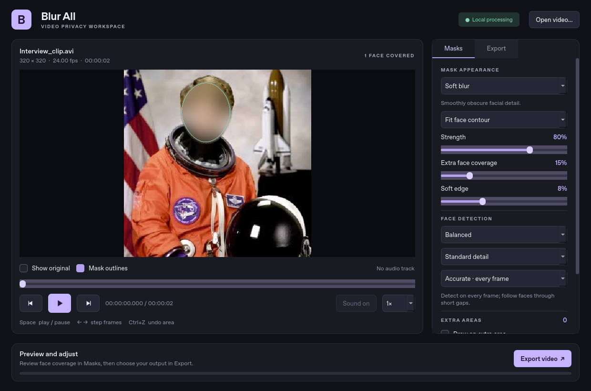
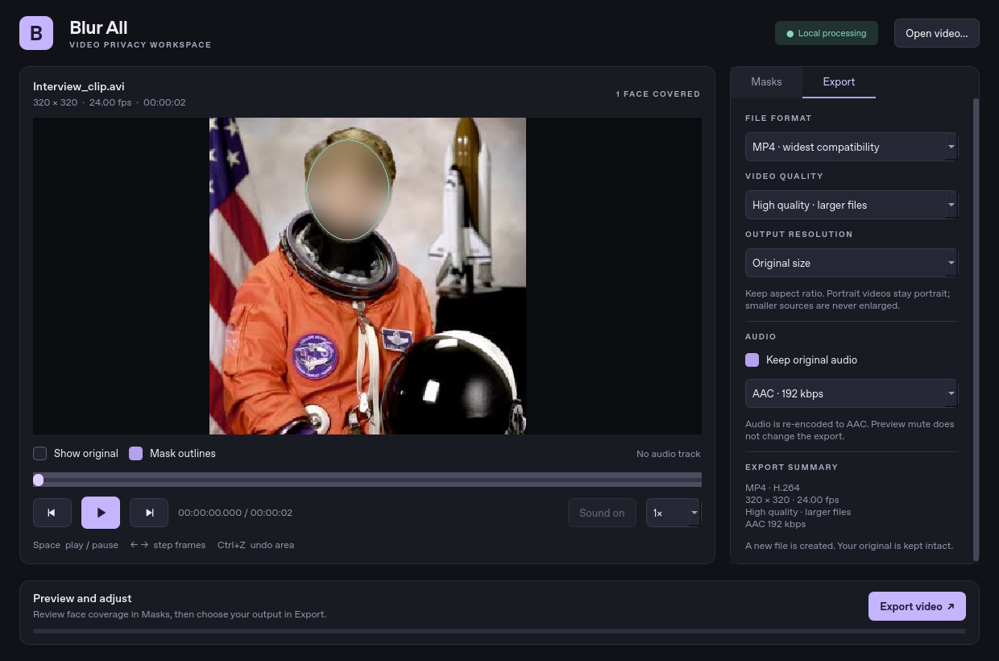

# Blur All

A Windows desktop application with face-fitting blur, pixelation, subtle distortion, and solid masks. Processing happens locally: no uploads, accounts, or API keys. It exports H.264 video to MP4, MOV, or MKV with optional AAC audio, and never overwrites an existing file.



## Use on Windows

Download **BlurAll-Installer** from a successful GitHub Actions run, extract the archive, and run `BlurAll-Setup-0.4.0.exe`. The per-user installer creates a Start menu entry and offers a desktop shortcut. You can uninstall it through Windows Settings. It does not require administrator rights, Python, a separate FFmpeg installation, or Internet access during use.

For a portable copy, extract the **whole** `BlurAll-Windows` archive and open `BlurAll.exe`. Keep the `_internal` folder beside the executable. Installer and portable binaries are unsigned, so Windows may show an unfamiliar-publisher prompt.

To run from this source repository:

1. Install 64-bit Python **3.12** (or 3.11) from python.org, including the Python launcher.
2. Double-click `scripts\run_windows.bat`. Its first run installs the pinned dependencies into `.venv` and needs Internet access to PyPI. Subsequent app processing works offline.
3. Click **Open video** or drag a video into the window. Use **Space** to play/pause, **Left/Right** to step one frame, or the timeline to seek. Preview speed ranges from 0.25× to 2×. Preview audio has its own mute control; muting it does not change the export.
4. In **Masks**, choose **Soft blur**, **Pixelate / mosaic**, **Slight distortion**, or **Solid cover**. The default **Fit face contour** follows the forehead, cheeks, and jaw using the eyes, nose, and mouth. **Oval** and **Rectangle** are also available. Adjust **Extra face coverage** and **Soft edge**; feathering extends outside the contour while its interior stays fully covered. Use **Show original** and **Mask outlines** to review placement. Pixelation has an adjustable block size; slight distortion starts at 25% and can leave a face recognizable.
5. For missed faces or other private details, enable **Draw an extra area** and drag on the paused preview. **Undo** / **Ctrl+Z** removes the last area; **Clear all** removes every drawn area. These manual rectangles stay fixed for the entire video. Automatic face contours rotate and scale with tracking; manually drawn areas also cover non-face objects.
6. In **Export**, choose a format, quality preset, resolution, and audio settings. Click **Export video** and pick an unused filename. Processing speed and an estimated time remaining appear while encoding. Cancel safely at any time before completion.
7. Use **Review export** to open the completed file in your default player, then check it before sharing. The completion message reports how many frames had a detected or tracked face covered; a zero count is not proof that the video has no faces.

The tracking selector defaults to **Accurate · every frame**. **Balanced · faster** detects every two frames and **Fast · quickest** every four, while motion tracking follows existing faces between checks. A scene cut or unreliable motion triggers an immediate detector refresh. When no faces are being tracked, all modes look for new faces on every frame. Faster modes can miss a new face that appears briefly between scheduled checks while other faces are already tracked; use Accurate for the most thorough review.


## Export controls



| Control | Choices and behavior |
| --- | --- |
| Format | MP4, MOV, or MKV; all use H.264 video and optional AAC audio. MP4/MOV are finalized for fast playback startup. |
| Quality | High (CRF 18, default), Balanced (CRF 22), or Smaller file size (CRF 26). Lower CRF keeps more detail and usually creates a larger file; exact size depends on the video. |
| Resolution | Original size, 1080p, 720p, or 480p. Portrait orientation and aspect ratio are preserved within even-pixel codec rounding; small videos are never enlarged. |
| Audio | Keep or remove audio; AAC at 128, 192 (default), or 256 kbps. Preview mute is independent. |

The summary shows actual output dimensions and frame rate before export. Face masking runs at source resolution before the image is resized. Original files are never overwritten.

Contours are estimated from five facial landmarks and the detector's bounds. They provide rounded, oriented coverage rather than a pixel-level segmentation of skin or hair. Review profiles, partially visible faces, and fast motion; increase coverage or add a manual area when needed.

## Build the Windows program

Run on Windows using Python 3.12:

```powershell
py -3.12 -m venv .venv
.venv\Scripts\python.exe -m pip install -r requirements-dev.txt
.venv\Scripts\python.exe -m pytest -v
.venv\Scripts\python.exe scripts\build_windows.py
```

The portable program is written to `dist\BlurAll\BlurAll.exe`. Distribute the **entire `dist\BlurAll` folder** as a ZIP. The build includes the face model, FFmpeg, and dependency notices.

To also build the installer, install **Inno Setup 6** on Windows, then run:

```powershell
.venv\Scripts\python.exe scripts\build_installer.py
```

This creates `dist\installer\BlurAll-Setup-0.4.0.exe`. Installer upgrades use a stable application ID and the default per-user directory. They preserve videos stored outside the application directory. Avoid saving personal files inside the installed program folder.

Alternatively, run **Actions → Windows build → Run workflow**. The workflow tests the application, builds and smoke-tests the portable program, then compiles the installer and verifies install, launch, a real video export, and uninstall on a disposable Windows runner. It uploads **BlurAll-Windows** and **BlurAll-Installer** artifacts. The workflow also runs on pull requests and pushes to `main`; it does not create a public release. Windows executables and the installer must be built on Windows. The installation test script is restricted to disposable GitHub-hosted runners so it cannot alter an existing local installation.

## Development

Use the existing checkout: cloud tasks already have isolated workspaces; creating a Git worktree is unnecessary.

```bash
python -m venv .venv
.venv/bin/python -m pip install -r requirements-dev.txt
.venv/bin/python -m blur_all
```

Run tests (including real face detection, video exports, audio decoding, and Qt interaction):

```bash
QT_QPA_PLATFORM=offscreen .venv/bin/python -m pytest -v
QT_QPA_PLATFORM=offscreen .venv/bin/python -m blur_all --smoke-test
```

On Windows, use `.venv\Scripts\python.exe` and set `$env:QT_QPA_PLATFORM = 'offscreen'` in PowerShell when testing without a display. Remove that variable before launching the normal desktop interface. Linux requires Qt's usual system display libraries for an interactive desktop; the cloud environment can validate the UI offscreen.

The model is bundled and its SHA-256 is checked on load. The application does not download models at runtime. `imageio-ffmpeg` supplies the encoder binary; a separately installed FFmpeg is not required. Test clips are generated in temporary directories.

## Format support and limitations

- Common MP4, MOV, MKV, AVI, WebM, WMV, and MPEG videos work when OpenCV's bundled FFmpeg decoder supports their codec. DRM-protected, corrupt, and unsupported-codec videos cannot be processed. No program can promise support for every possible video format.
- The default Accurate mode runs YuNet detection on **every export frame**, with adjustable extra coverage around each face. Fresh detections are associated one-to-one. Detection and landmark jitter are stabilized; robust affine flow propagates the mask's orientation, scale, and landmarks through short gaps. Old tracks expire after about half a second without detector confirmation; scene changes clear them. This short-term motion fallback does not identify people or guarantee that every face will be covered. Very small, obscured, or extreme-profile faces may be missed.
- Decoding, detection, and masking for previews run on a background thread. Preview playback can skip frames to keep up on slower machines; export processes every decoded frame using the selected detection mode. Seek or step through important moments, then review the finished export. Preview imagery is limited to a 1280-pixel longest edge; exports use the selected output resolution. Preview audio depends on the installed sound device and Qt's codec support; an unavailable preview audio backend does not prevent normal exports.
- Variable frame rate inputs are normalized to the decoder's reported average frame rate. Source timestamps are not preserved, so some phone/screen recordings can have audio synchronization drift. Review the output; convert to constant frame rate first if needed.
- Outputs are 8-bit SDR H.264 at the selected quality with optional AAC audio in MP4, MOV, or MKV. Audio is re-encoded. HDR color, subtitles, chapters, alternate video tracks, and original metadata are not preserved. Source-size odd dimensions are padded by one pixel for H.264 compatibility; resized output uses even dimensions. Videos that change resolution midstream are rejected.
- Export needs space for a temporary silent MP4 and the final container in the destination folder. Only the completed file appears under your chosen output name; temporary files are cleaned after cancellation and errors. A hard process crash can leave a `.blur-all-*` temporary folder for manual removal.
- Automatic blurring and adjustable blur strength do **not** guarantee anonymity. Check all sensitive frames and audio before sharing. Increase coverage or draw additional areas when necessary.

See [third-party notices](THIRD_PARTY_NOTICES.md) for model, framework, encoder, and test-image attribution.

## Historical tracking comparison: version 0.3 vs 0.2

[Recorded results](docs/tracking-benchmark.json) were measured for version 0.3 (`fc838fe`) against version 0.2 (`0029f23`) on Linux, Python 3.12, OpenCV 4.11, and four OpenCV threads. Each timing is the median of three 60-frame runs. Detection/tracking timings exclude decoding, mask rendering, video encoding, and audio; they are not whole-export throughput estimates or new version 0.4 measurements.

| Detection + tracking, generated 640×360 face clip | Median ms/frame | Speed relative to v0.2 |
| --- | ---: | ---: |
| v0.2 | 11.50 | 1.00× |
| Accurate | 9.64 | 1.19× |
| Balanced | 5.92 | 1.94× |
| Fast | 4.09 | 2.81× |

All four modes covered the known reference face box in all 60 frames at an overlap threshold of 0.5. A separate tracker-only test with fresh detections for three faces in a 1280×720 frame improved from 5.58 to 1.05 ms/frame (5.31×). This is where skipping unnecessary optical-flow calculations helps most.

For generated rotation/scale motion with five-frame gaps between observations, mean box overlap improved from 0.906 to 0.932. The fraction of frames above 0.75 overlap rose from 93.3% to 96.7%. Conservative smoothing may reduce overlap scores for tightly fitted reference boxes while still preserving coverage. These controlled sequences are not a labeled real-world accuracy study; speed and coverage depend on hardware, face sizes, crowding, motion, and codecs.

To repeat the comparison from a checkout containing the baseline commit:

```bash
.venv/bin/python scripts/benchmark_tracking.py --baseline 0029f23 --output /tmp/tracking-benchmark.json
```
